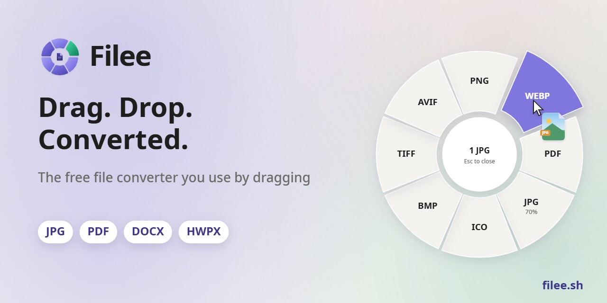
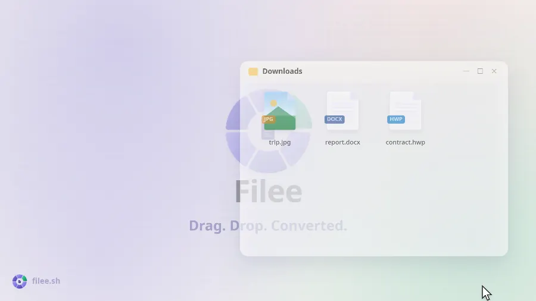
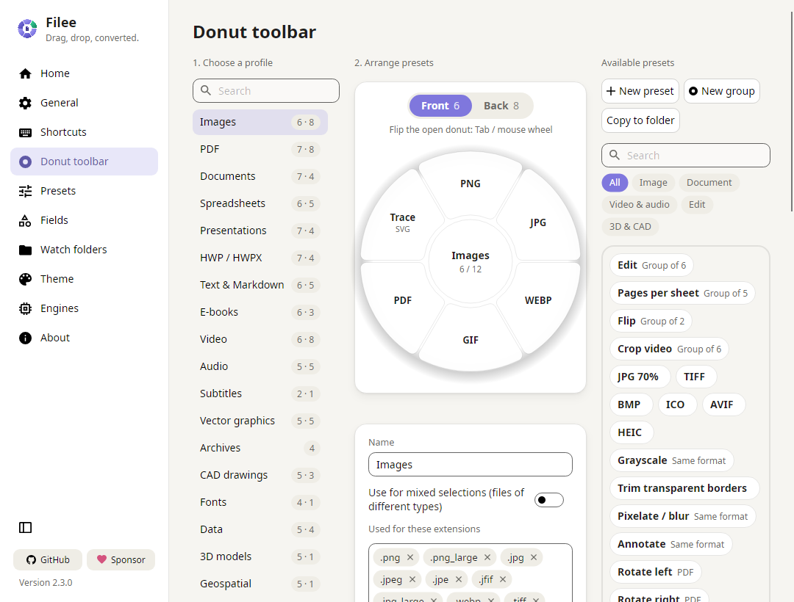
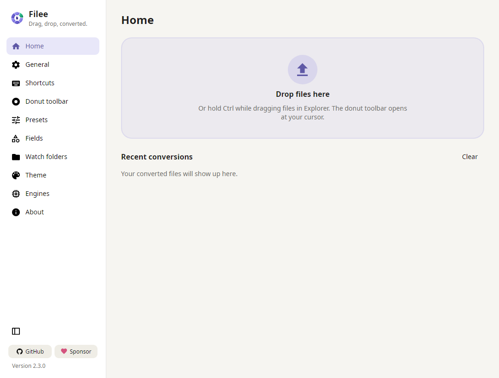

<p align="center">
  <a href="https://filee.sh"></a>
</p>

<p align="center">
  <b>ড্র্যাগ করে ব্যবহারের একটি মুক্ত ও উন্মুক্ত উৎসের ফাইল কনভার্টার।</b><br>
  একটি কী চেপে ধরে রাখুন (macOS-এ <kbd>Ctrl</kbd>, <kbd>Option</kbd>), ফাইল টেনে আনুন এবং কার্সারে উন্মুক্ত হওয়া ডোনাটের নির্দিষ্ট ফরম্যাটে ছেড়ে দিন।
</p>

<p align="center">
  <a href="https://filee.sh"><b>ওয়েবসাইট</b></a> ·
  <a href="https://github.com/KnifeLemon/Filee/releases/latest"><b>ডাউনলোড</b></a> ·
  <a href="https://www.linkedin.com/company/filee-sh/"><b>LinkedIn</b></a> ·
  <a href="#ইনস্টল">ইনস্টল</a> ·
  <a href="#কমান্ড-লাইন">কমান্ড লাইন</a> ·
  <a href="#ডেভেলপমেন্ট">ডেভেলপমেন্ট</a>
</p>

<p align="center">
  <a href="https://github.com/KnifeLemon/Filee/actions/workflows/ci.yml"></a>
  <a href="https://github.com/KnifeLemon/Filee/releases/latest"></a>
  <a href="https://github.com/KnifeLemon/Filee/releases"></a>
  
  
  
  <a href="LICENSE"></a>
</p>

<p align="center">
  <a href="https://trendshift.io/repositories/276987"></a>
  <a href="https://trendshift.io/repositories/276987"></a>
  <a href="https://hellogithub.com/repository/KnifeLemon/Filee" target="_blank"></a>
</p>

<p align="center">
  <a href="README.md">English</a> ·
  <a href="README.es.md">Español</a> ·
  <a href="README.ja.md">日本語</a> ·
  <a href="README.ko.md">한국어</a> ·
  <a href="README.zh-CN.md">简体中文</a> ·
  <a href="README.zh-TW.md">繁體中文</a> ·
  <a href="README.pl.md">Polski</a> ·
  <a href="README.hi.md">हिन्दी</a> ·
  <b>বাংলা</b> ·
  <a href="README.ru.md">Русский</a> ·
  <a href="README.ar.md">العربية</a> ·
  <a href="README.pt-BR.md">Português (Brasil)</a> ·
  <a href="README.pt-PT.md">Português (Portugal)</a> ·
  <a href="README.fr.md">Français</a> ·
  <a href="README.th.md">ไทย</a> ·
  <a href="README.tr.md">Türkçe</a> ·
  <a href="README.id.md">Bahasa Indonesia</a> ·
  <a href="README.it.md">Italiano</a>
  <a href="README.bn-BD.md">বাংলা</a> ·
</p>

<table>
  <tr>
    <td width="33%" valign="top">
      <b>সরাসরি আপনার কার্সারে</b><br>
      কোনো অ্যাপ উইন্ডো খোলার ঝামেলা নেই।
      আপনি যেখানে আছেন ফরম্যাটগুলো ঠিক সেখানেই প্রদর্শিত হয়, কেবল আপনার ড্র্যাগ করা ফাইলের জন্য উপযোগী ফরম্যাটগুলোই দেখায়।
    </td>
    <td width="33%" valign="top">
      <b>২৭০টি ফরম্যাট, অন্য কোনো সফটওয়্যার ছাড়াই</b><br>
      Office, Hancom Office বা LibreOffice ছাড়াই ছবি, PDF, Word, Excel, PowerPoint, HWP, ই-বুক, আর্কাইভ, ফন্ট, CAD, 3D মডেল এবং ভৌগোলিক উপাত্ত কাজ করে।
    </td>
    <td width="33%" valign="top">
      <b>আপনার কম্পিউটারে নিরাপদ</b><br>
      কোনো কিছুই ইন্টারনেটে আপলোড করা হয় না।
      Filee অফলাইনে কাজ করে এবং ফলাফল মূল ফাইলের পাশেই সংরক্ষণ করে।
    </td>
  </tr>
</table>

## কার্যপদ্ধতি দেখুন

<p align="center">
  <a href="https://filee.sh"></a><br>
  <sub>২৭ সেকেন্ডের ভিডিওটি দেখুন এবং <a href="https://filee.sh">filee.sh</a>-এ ইন্টারঅ্যাক্টিভ ডেমোটি চালিয়ে দেখুন</sub>
</p>

## ইনস্টল

[Releases](https://github.com/KnifeLemon/Filee/releases/latest) থেকে ডাউনলোড করুন।

<a href="https://apps.microsoft.com/detail/XPDCN05L89WS0C?referrer=appbadge&cid=github&mode=full"></a>

অথবা WinGet দিয়ে:

```powershell
winget install KnifeLemon.Filee
```

- **Windows 10/11**: `Filee-<version>-win-Setup.exe` চালান, অথবা `win-Portable.zip` আনজিপ করে `Filee.exe` চালান।
  - Setup হলো Filee-র নিজস্ব ইনস্টলার, Filee-র বিভিন্ন ভাষায় উপলব্ধ, এবং কম্পিউটারে অন্য কিছুর প্রয়োজন পড়ে না।
  - এটি Explorer মেনু, সাইন-ইনের সময় স্বয়ংক্রিয় চালু, `filee` কমান্ড এবং ঐচ্ছিক ইঞ্জিনগুলো যোগ করতে পারে।
  - সাইলেন্ট ইনস্টলেশন Inno Setup-এর সুইচগুলো সমর্থন করে (`/VERYSILENT /SUPPRESSMSGBOXES`)।
- **macOS 13+** (প্রিভিউ): `osx-arm64` বা `osx-x64` প্যাকেজটি আনপ্যাক করুন এবং `./install.sh` চালান।
  - অথবা `.dmg` ফাইলটি খুলে Filee-কে Applications ফোল্ডারে টেনে আনুন (`install.sh`-এর সাথে `filee` কমান্ড আসে)।
  - বিল্ডটি এখনও নোটারাইজ করা হয়নি, তাই System Settings → Privacy & Security → **Open Anyway** দিয়ে প্রথমবার চালুর অনুমতি দিন।
- **Linux x64/ARM64** (Ubuntu 22.04+): প্যাকেজটি আনপ্যাক করুন এবং `./install.sh` চালান (রুট পারমিশন লাগে না, Python 3 প্রয়োজন)।
  - ড্র্যাগ জেসচারের জন্য X11 প্রয়োজন।
    Wayland-এ ড্রপ জোন এবং ফাইল ম্যানেজারের রাইট-ক্লিক মেনু ব্যবহার করুন।

Filee এর মেনুতে নতুন রিলিজ প্রদর্শন করে এবং আপনার সেটিংস ও ইঞ্জিনগুলো অক্ষুণ্ণ রেখে নিজে আপডেট হয়।
আপডেটের পর কয়েকটি স্লাইডের মাধ্যমে নতুন কী যুক্ত হয়েছে তা দেখানো হয়।

**Windows: Filee চালু হচ্ছে না (কোনো উইন্ডো নেই, কোনো ত্রুটি নেই)?**
এমনটি ঘটে অনেকদিন আপডেট না হওয়া Windows 10-এ, এমন পিসিতে যার প্রসেসর Hardware-enforced Stack Protection (CET) সমর্থন করে।
Windows সেই সুরক্ষা চালু করে কিন্তু .NET-এর প্রয়োজনীয় একটি উপাদান অনুপস্থিত থাকে, ফলে Filee এবং Setup সাথে সাথে বন্ধ হয়ে যায়।

- **সুপারিশ:** উপলব্ধ Windows আপডেটগুলো ইনস্টল করুন (সর্বশেষ কিউমুলেটিভ আপডেট)।
- **যদি আপডেট করা সম্ভব না হয়:** কেবল Filee-র জন্য সুরক্ষাটি বন্ধ করলে সাধারণত কাজ করে।
  প্রশাসক হিসেবে PowerShell-এ এটি চালান:

```powershell
Set-ProcessMitigation -Name Filee.exe -Disable UserShadowStack
Set-ProcessMitigation -Name filee-cli.exe -Disable UserShadowStack
```

Setup-এর ফাইলের নামের ক্ষেত্রেও একই কাজ করুন (যেমন `Filee-<version>-win-Setup.exe`), অথবা পোর্টেবল জিপ ব্যবহার করুন, যার জন্য কেবল এই দুটি লাইনের প্রয়োজন।
পূর্বাবস্থায় ফিরিয়ে নিতে Windows Security → App & browser control → Exploit protection settings → Program settings থেকে এন্ট্রিগুলো মুছে দিন।

## সুবিধাসমূহ

- **কার্সারে ডোনাট টুলবার**: একটি কী চেপে ধরে ফাইল টেনে আনুন এবং একটি ফরম্যাটের ওপর ছেড়ে দিন।
  কেবল ফাইলের সাথে মানানসই ফরম্যাটগুলো প্রদর্শিত হয়।
- **সরাসরি ব্রাউজার থেকে**: একইভাবে Chrome, Edge, Firefox বা Safari থেকে কোনো ছবি, ফাইলের লিঙ্ক বা ডাউনলোড টেনে আনুন।
  - Filee এটি আপনার Downloads ফোল্ডারে সংরক্ষণ করে (অথবা কেবল রূপান্তরিত ফাইলটি রাখে) এবং রূপান্তর করে।
  - আপনার ব্রাউজারের সাইন-ইন ছাড়াই লিঙ্কগুলো ডাউনলোড করা হয়।
- **প্রতিটি ফাইলের ধরনের জন্য একটি টুলবার**, যা ড্র্যাগ অ্যান্ড ড্রপ করে সাজানো যায়, এবং এতে নিচের বিষয়গুলোর জন্য প্রিসেট রয়েছে:
  - গুণমান, আকার, DPI
  - PDF পৃষ্ঠা এবং সংকোচন (কম্প্রেশন)
  - ভিডিও এবং অডিও
  - আউটপুট ফোল্ডার এবং ফাইলের নাম
- **প্রতিটি ডোনাটের দুটি পিঠ**: আরও কম প্রচলিত ফরম্যাট এবং টুল দেখতে উন্মুক্ত থাকা অবস্থায় <kbd>Tab</kbd> চাপুন বা মাউস হুইল ঘুরিয়ে উল্টান।
- **রূপান্তরের আগে ক্রপ**: ক্রপ স্লাইস ছবিগুলো একে একে খোলে।
  ফ্রেম ড্র্যাগ করুন, অনুপাত নির্বাচন করুন এবং কেবল ওই অংশটি সংরক্ষিত হবে।
- **একসাথে অনেক ফাইল**, সমান্তরালভাবে রূপান্তর।
  একাধিক ধাপের রুটগুলো (HWP → HWPX → DOCX) স্বয়ংক্রিয়ভাবে খুঁজে নেয়।
- **ওয়াচ ফোল্ডার** এতে আসা প্রতিটি ফাইল স্বয়ংক্রিয়ভাবে রূপান্তর করে।
- **হোম স্ক্রিনে সাম্প্রতিক রূপান্তর**, প্রতিটির থাম্বনেইলসহ: ফলাফল খুলুন, অথবা অন্য কোনো অ্যাপ দিয়ে খুলুন।
- **হোম স্ক্রিনে ফাইলের তালিকা**: সাধারণ সেটিংসে *ছেড়ে দেওয়া ফাইলগুলো একটি তালিকায় সংগ্রহ করুন* চালু করুন, এবং হোম স্ক্রিনে ড্রপ করা ফাইলগুলো (ব্রাউজার থেকে টেনে আনা ফাইলসহ) ডোনাট খোলার বদলে একটি তালিকায় অপেক্ষা করবে।
  কার্ড টেনে এনে বা Alt+↑ / Alt+↓ চেপে ক্রম ঠিক করুন, মুছে ফেলতে Delete চাপুন, এবং সেই ক্রম অনুযায়ী তালিকার জন্য ডোনাট খুলতে *অ্যাকশন নির্বাচন করুন* চাপুন।
  রূপান্তর শেষ হলে তালিকাটি খালি হয়ে যায়।
- **ব্যবহারের অন্যান্য উপায়**: রাইট-ক্লিক মেনু, কীবোর্ড শর্টকাট, ড্রপ জোন এবং [`filee` কমান্ড](#কমান্ড-লাইন)।
- নিজস্ব অ্যাকসেন্ট রঙ এবং ডোনাট স্বচ্ছতাসহ লাইট ও ডার্ক থিম; English, Español, 日本語, 한국어, 简体中文, 繁體中文, Polski, हिन्दी, বাংলা, Русский, العربية (ডান থেকে বাম), Português (Brasil), Français, नेपाली, ไทย, Türkçe, Português (Portugal), Deutsch, Italiano, Bahasa Indonesia এবং Tiếng Việt ভাষায় উপলব্ধ।

## স্ক্রিনশট

<table>
  <tr>
    <td width="50%"></td>
    <td width="50%"></td>
  </tr>
  <tr>
    <td align="center"><sub>ড্র্যাগ ও ড্রপ দিয়ে ডোনাট সাজান, প্রতি ফাইল টাইপের জন্য একটি প্রোফাইল</sub></td>
    <td align="center"><sub>হোম: ড্রপ জোন এবং সাম্প্রতিক রূপান্তর</sub></td>
  </tr>
</table>

## ফরম্যাটসমূহ

| উৎস ফরম্যাট | লক্ষ্য ফরম্যাট |
|---|---|
| **ছবি**: JPG, PNG, WEBP, AVIF, TIFF, BMP, GIF, APNG, ICO, ICNS, JPEG XL, JPEG 2000, PSD/PSB, TGA, PPM, HEIC, QOI, DDS, PCX, MNG, CUR, …;<br>GIMP XCF, ক্যামেরা RAW (CR2, CR3, NEF, ARW, DNG, …), DICOM, OpenEXR, HDR, FITS, JPEG XR (Windows), iPhone Live Photo (LIVP) পাঠযোগ্য | এগুলোর যেকোনোটি (HEIC⁵), PDF, SVG (ট্রেস করা), আকার পরিবর্তিত, গ্রেস্কেল;<br>Live/Motion Photo (iPhone, Android) → সেগুলোর ভিডিও (MP4, MOV⁵), এবং ভিডিও → Live Photo (iPhone) বা Motion Photo (Android)⁵, পরীক্ষামূলক |
| **ভেক্টর**: SVG, SVGZ, EMF, WMF, AI<br>EPS, PS¹<br>CDR, VSD, CGM, ODG, FODG² | PDF (ভেক্টর), PNG এবং অন্যান্য ছবি,<br>SVG ↔ SVGZ, SVG → DXF/DWG, PDF → EPS/PS¹, SVG → EMF, WMF, ODG² |
| **PDF** | DOCX, HWPX, TXT, PNG, JPG, TIFF, CBZ, PPTX (প্রতি পৃষ্ঠার একটি ছবি), SVG²;<br>একত্রিত (আপনার বাছাই করা ক্রমে), বিভক্ত, পৃষ্ঠার পরিসর, সংকোচন (ছোট আকারের PDF) |
| **নথি**: DOCX, DOCM, DOTX, EML, Outlook MSG;<br>OFD (চীনা ই-চালান, সরকারি নথি) পাঠযোগ্য<br>DOC, ODT, FODT, OTT, RTF, WPS, WPD, Pages, ClarisWorks, MacWrite, T602, …² | PDF, DOCX, HWPX, EPUB, TXT, HTML;<br>MSG → EML<br>ODT, FODT, OTT² |
| **স্প্রেডশিট**: XLSX, XLSM, XLS, XLT, ODS, CSV, TSV<br>OTS, FODS, Numbers, ET² | PDF, XLSX, ODS, CSV, TSV, JSON, HWPX, HTML<br>XLT, OTS² |
| **উপস্থাপনা**: PPTX, PPTM, POTX, POTM, PPSX<br>PPT, ODP, OTP, FODP, Keynote² | PDF, PNG, JPG, DOCX, HWPX<br>OTP² |
| **HWP**: HWP, HWPX | PDF, PNG, DOCX, HWPX ↔ HWP, TXT, Markdown, HTML |
| **টেক্সট**: TXT, LOG, স্ক্রিপ্ট সোর্স (PY, PAC, BAT, COMMAND; পাঠযোগ্য, কখনো চালানো হয় না), Markdown, HTML;<br>MHTML (সংরক্ষিত ওয়েব পেজ) পাঠযোগ্য<br>reStructuredText, LaTeX, Org, AsciiDoc, Typst, MediaWiki, DocBook, Jupyter, Textile, man, OPML³ | UTF-8 TXT, PDF, DOCX, HWPX, EPUB<br>একে অপরে রূপান্তর, PPTX স্লাইড³ |
| **ই-বুক**: EPUB, KEPUB, MOBI, AZW3, AZW, AZW4, FB2, CBZ, CBR, CB7, HTMLZ, TXTZ<br>LIT, LRF, CHM, PDB, …⁴ | PDF, EPUB, KEPUB (Kobo), DOCX, TXT, HTML, HWPX<br>MOBI, AZW3⁴ |
| **ভিডিও**⁵: MP4, MOV, MKV, WEBM, AVI, WMV, FLV, MPEG, Video CD (DAT), TS, M2TS, 3GP, OGV, VOB, … | MP4 (H.264, HEVC, AV1), WEBM, MOV, MKV, AVI, GIF, APNG, MP3, M4A, 720p,<br>সাবটাইটেল (SRT, ASS, WebVTT) |
| **অডিও**⁵: MP3, M4A, AAC, WAV, FLAC, OGG, OPUS, WMA, AIFF, AMR, APE, WavPack, TTA, DSD (DSF, DFF), DTS, AC3, E-AC3, … | MP3, M4A (AAC, ALAC), WAV, FLAC, OGG, OPUS, AAC, WavPack, TTA, W64, AC3, E-AC3 |
| **সাবটাইটেল**: SRT, ASS/SSA, WebVTT, SAMI (SMI), LRC, TTML, MicroDVD, SCC | UTF-8 হিসেবে একে অপরে রূপান্তর (কোরিয়ান CP949 ফাইল সঠিকভাবে পড়ে) |
| **আর্কাইভ**: ZIP, ANSYS Workbench (WBPZ), 7Z, RAR, TAR, TAR.GZ, TAR.BZ2, TAR.XZ, GZ, ISO, CAB, DMG, ALZ, EGG, … | আনপ্যাক, ZIP, 7Z, TAR, TAR.GZ;<br>যেকোনো ফাইল → একটি একক ZIP |
| **CAD**: DWG, DXF | PDF, SVG, PNG, DWG ↔ DXF |
| **ফন্ট**: TTF, OTF, WOFF, WOFF2, EOT;<br>FON (Windows বিটম্যাপ ফন্ট) পাঠযোগ্য | একে অপরে রূপান্তর;<br>FON → আকার প্রতি একটি ফন্ট |
| **উপাত্ত**: JSON, JSON Lines, YAML, TOML, XML<br>vCard, iCalendar | একে অপরে রূপান্তর, CSV এবং XLSX (সারণি);<br>vCard, iCalendar ↔ CSV |
| **3D মডেল**: GLB, glTF, STL, OBJ (+ MTL), 3MF, PLY;<br>FBX পাঠযোগ্য | একে অপরে রূপান্তর, PNG প্রিভিউ |
| **ভৌগোলিক ভেক্টর**: Shapefile, GeoJSON, KML, KMZ, GPX<br>স্থানাঙ্কসহ CSV; Garmin FIT পাঠযোগ্য | একে অপরে রূপান্তর এবং CSV / XLSX / JSON;<br>প্রজেক্টেড উপাত্ত (UTM, Web Mercator, Lambert, Albers) WGS 84 দ্রাঘিমাংশ / অক্ষাংশ হিসেবে তৈরি হয় |

চিহ্নহীন ফরম্যাটগুলো সরাসরি কোনো Office, Hancom Office বা LibreOffice ছাড়াই কাজ করে।
চিহ্নযুক্ত ফরম্যাটগুলোর জন্য ঐচ্ছিক ইঞ্জিনের প্রয়োজন হয়, যা কেবল প্রয়োজন হলেই ডাউনলোড করা হয়: ¹ Ghostscript, ² LibreOffice, ³ Pandoc, ⁴ calibre, ⁵ FFmpeg ([বিস্তারিত](docs/ENGINES.md))।

## কমান্ড লাইন

`filee` কমান্ড অ্যাপের অনুরূপ ইঞ্জিন ও প্রিসেট ব্যবহার করে (সেটআপ বা `install.sh` এটি যুক্ত করে)।

```
filee convert photo.heic --to jpg
filee convert *.png --to webp --quality 80 -o converted
filee watch D:\Inbox --to pdf --move-originals
```

প্রতিটি কমান্ড এবং বিকল্প: [filee.sh/cli](https://filee.sh/cli/) বা `filee help`।

## ডেভেলপমেন্ট

Windows, macOS বা Linux-এ .NET 10 SDK দিয়ে বিল্ড করুন:

```bash
git clone https://github.com/KnifeLemon/Filee.git
cd Filee
pwsh build/fetch-engines.ps1 -Only rhwp,pandoc   # ঐচ্ছিক ইঞ্জিন
dotnet run --project src/Filee.App
dotnet test
```

[আর্কিটেকচার](docs/ARCHITECTURE.md) · [ইঞ্জিনসমূহ](docs/ENGINES.md) · [কনভার্টার যোগ করা](docs/ADDING-A-CONVERTER.md) · [ভাষা যোগ করা](docs/ADDING-A-LANGUAGE.md) · [অবদান রাখা](CONTRIBUTING.md)

পুল রিকোয়েস্ট সাদরে গৃহীত।
Filee যদি আপনার কিছু ক্লিকের সময় বাঁচায়, তবে একটি ⭐ অন্যদের এটি খুঁজে পেতে সাহায্য করবে।

## কোড সাইনিং নীতিমালা

Filee তৈরি এবং প্রকাশ করেছেন **Myeonggu Kim** ([KnifeLemon](https://github.com/KnifeLemon))।

- Windows রিলিজগুলো Myeonggu Kim-এর নামে ইস্যু করা একটি [Certum](https://www.certum.eu/) ওপেন সোর্স কোড সাইনিং সার্টিফিকেট দিয়ে স্বাক্ষরিত ("Open Source Developer MYEONGGU KIM")।
  - এর আগের সংস্করণগুলো, 2.0.0 পর্যন্ত, স্বাক্ষরিত নয়।
  - পর্যাপ্ত ডাউনলোড না হওয়া পর্যন্ত SmartScreen নতুন রিলিজের ক্ষেত্রে সতর্কতা প্রদর্শন করতে পারে ("More info" → "Run anyway")।
- macOS প্যাকেজগুলো অ্যাড-হক স্বাক্ষরিত এবং নোটারাইজড নয়।
- কেবল এই রিপোজিটরির GitHub Actions রিলিজ ওয়ার্কফ্লো দিয়ে তৈরি ফাইলগুলো স্বাক্ষরিত হয়, এবং প্রতিটি রিলিজ নিজ হাতে যাচাই ও স্বাক্ষর করা হয়।
  - নির্মাতাদের দ্বারা স্বাক্ষরিত লাইব্রেরি এবং প্রোগ্রামগুলো (.NET, SkiaSharp, ImageMagick, Microsoft C++ রানটাইম…) তাদের নিজস্ব স্বাক্ষর বজায় রাখে; অবিকল যে অংশগুলো স্বাক্ষরহীন আসে (rhwp, 7-Zip এবং বেশিরভাগ লাইব্রেরি) সেগুলো Filee-র অংশ হিসেবে Filee-র সার্টিফিকেট দিয়ে স্বাক্ষরিত হয়।

### গোপনীয়তা নীতিমালা

Filee আপনার নিজস্ব কম্পিউটারে ফাইল রূপান্তর করে এবং কখনো সেগুলো আপলোড করে না।
এটি কোনো ব্যবহারের উপাত্ত সংগ্রহ করে না এবং কোনো টেলিমেট্রি পাঠায় না।
এটি কেবল নিচের ক্ষেত্রগুলোতেই ইন্টারনেটের সাথে যুক্ত হয়:

- চালুর কিছুক্ষণ পর এবং প্রতি কয়েক ঘণ্টা অন্তর GitHub-কে (`api.github.com`) জিজ্ঞাসা করতে যে কোনো নতুন রিলিজ এসেছে কি না।
  সেটিংস → পরিচিতি ("স্বয়ংক্রিয়ভাবে আপডেটের জন্য পরীক্ষা করুন") থেকে এটি বন্ধ করতে পারেন।
- [`engines.json`](src/Filee.Engines/Infrastructure/engines.json)-এ নির্দিষ্ট অফিশিয়াল অবস্থান থেকে আপনার ইনস্টল করার জন্য বেছে নেওয়া রূপান্তর ইঞ্জিনগুলো এবং [`ocr-languages.json`](src/Filee.Engines/Infrastructure/ocr-languages.json)-এ নির্দিষ্ট প্রিসেটের প্রয়োজনীয় টেক্সট শনাক্তকরণ (OCR) ভাষাগুলো ডাউনলোড করতে।
- আপনি যখন কোনো লিঙ্কে ক্লিক করেন, যা আপনার ওয়েব ব্রাউজার খুলে দেয়।

## স্পনসর

Filee সম্পূর্ণ ফ্রি এবং সর্বদাই ফ্রি থাকবে।
আপনি যদি সমর্থন করতে চান, তবে আপনার সুবিধাজনক যেকোনো উপায় বেছে নিন ([Fairy](https://fairy.hada.io/@filee) কোরিয়ান কার্ড এবং সহজ পেমেন্ট গ্রহণ করে)।

**আপনার নাম বা লোগো এখানে রাখুন।**
মাসিক সহায়তাকারীদের নাম এখানে তালিকাভুক্ত করা হয়, এবং স্পনসররা এখানে ও Filee-র ‘পরিচিতি’ পেজে তাদের লোগো প্রদর্শন করতে পারেন।
এককালীন সহায়তাকারীরাও তাদের নাম তালিকায় রাখার অনুরোধ করতে পারেন।

<!-- sponsors: src/Filee.App/Assets/Sponsors/sponsors.json -->

<p align="center">
  <a href="https://github.com/sponsors/KnifeLemon"></a>
  <a href="https://patreon.com/KnifeLemon"></a>
  <a href="https://ko-fi.com/knifelemon"></a>
  <a href="https://paypal.me/knifelemon"></a>
  <a href="https://fairy.hada.io/@filee"></a>
</p>

## লাইসেন্স

MIT, © 2026 Myeonggu Kim (KnifeLemon) এবং Filee অবদানকারীগণ।
যুক্ত তৃতীয় পক্ষের উপাদানগুলোর নিজস্ব লাইসেন্স বহাল রয়েছে, যা [THIRD-PARTY-NOTICES.md](THIRD-PARTY-NOTICES.md)-এ তালিকাভুক্ত।

<p align="center">
  <a href="https://star-history.com/#KnifeLemon/Filee&Date"></a>
</p>
