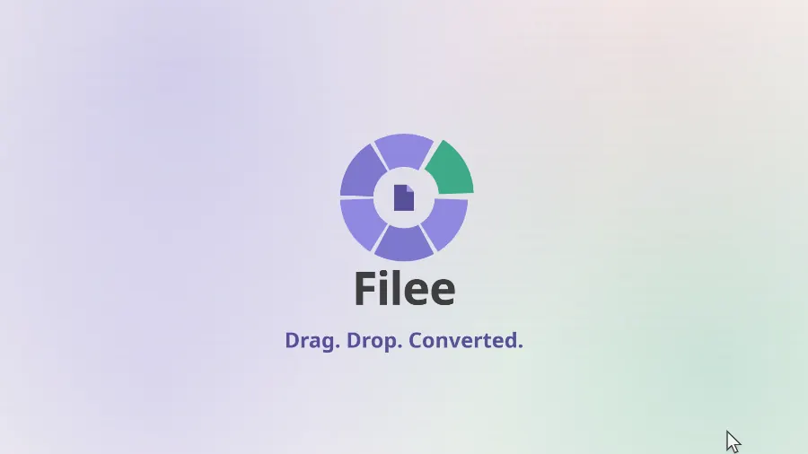
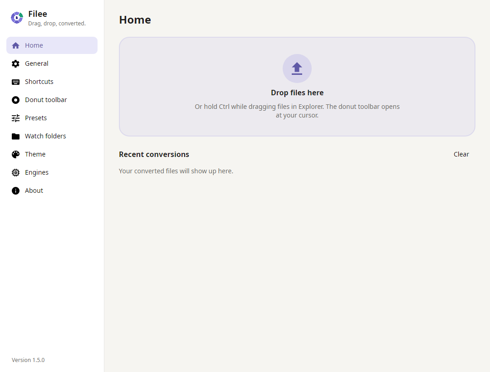

<p align="center">
  <a href="https://filee.sh"></a>
</p>

<p align="center">
  <b>Konverter file gratis dan open-source yang digunakan cukup dengan menyeret (drag & drop).</b><br>
  Tahan tombol (<kbd>Ctrl</kbd>, atau <kbd>Option</kbd> di macOS), seret file, lalu lepas pada format di menu melingkar (donut) yang muncul tepat di kursor Anda.
</p>

<p align="center">
  <a href="https://filee.sh"><b>Situs Web</b></a> ·
  <a href="https://github.com/KnifeLemon/Filee/releases/latest"><b>Unduh</b></a> ·
  <a href="https://www.linkedin.com/company/filee-sh/"><b>LinkedIn</b></a> ·
  <a href="#instalasi">Instalasi</a> ·
  <a href="#baris-perintah-cli">Baris Perintah</a> ·
  <a href="#pengembangan">Pengembangan</a>
</p>

<p align="center">
  <a href="https://github.com/KnifeLemon/Filee/actions/workflows/ci.yml"></a>
  <a href="https://github.com/KnifeLemon/Filee/releases/latest"></a>
  <a href="https://github.com/KnifeLemon/Filee/releases"></a>
  
  
  
  <a href="LICENSE"></a>
</p>

<p align="center">
  <a href="https://trendshift.io/repositories/276987"></a>
  <a href="https://trendshift.io/repositories/276987"></a>
  <a href="https://hellogithub.com/repository/KnifeLemon/Filee" target="_blank"></a>
</p>

<p align="center">
  <a href="README.md">English</a> ·
  <a href="README.es.md">Español</a> ·
  <a href="README.ja.md">日本語</a> ·
  <a href="README.ko.md">한국어</a> ·
  <a href="README.zh-CN.md">简体中文</a> ·
  <a href="README.zh-TW.md">繁體中文</a> ·
  <a href="README.pl.md">Polski</a> ·
  <a href="README.hi.md">हिन्दी</a> ·
  <a href="README.ru.md">Русский</a> ·
  <a href="README.ar.md">العربية</a> ·
  <a href="README.pt-BR.md">Português (Brasil)</a> ·
  <a href="README.pt-PT.md">Português (Portugal)</a> ·
  <a href="README.fr.md">Français</a> ·
  <a href="README.th.md">ไทย</a> ·
  <a href="README.tr.md">Türkçe</a> ·
  <b>Bahasa Indonesia</b>
</p>

<table>
  <tr>
    <td width="33%" valign="top">
      <b>Tepat di Kursor Anda</b><br>
      Tidak perlu repot membuka jendela aplikasi. Pilihan format langsung muncul di posisi kursor Anda, dan hanya menampilkan format yang relevan dengan file yang diseret.
    </td>
    <td width="33%" valign="top">
      <b>270 Format, Tanpa Aplikasi Lain</b><br>
      Mendukung Gambar, PDF, Word, Excel, PowerPoint, HWP, e-book, arsip/kompresi, font, CAD, model 3D, hingga data geospasial tanpa perlu menginstal Microsoft Office, Hancom Office, maupun LibreOffice.
    </td>
    <td width="33%" valign="top">
      <b>Tetap Aman di Komputer Anda</b><br>
      Tidak ada file yang diunggah ke cloud. Filee bekerja sepenuhnya secara offline dan menyimpan hasil konversi tepat di samping file aslinya.
    </td>
  </tr>
</table>

## Lihat Cara Kerjanya

<p align="center">
  <a href="https://filee.sh"></a><br>
  <sub>Tonton video 27 detik dan coba demo interaktifnya langsung di <a href="https://filee.sh">filee.sh</a></sub>
</p>

## Instalasi

Unduh melalui halaman [Releases](https://github.com/KnifeLemon/Filee/releases/latest).

<a href="https://apps.microsoft.com/detail/XPDCN05L89WS0C?referrer=appbadge&cid=github&mode=full"></a>

- **Windows 10/11**: Jalankan `Filee-<version>-win-Setup.exe`, atau ekstrak `win-Portable.zip` lalu jalankan `Filee.exe`.
  - Installer bawaan Filee mendukung berbagai bahasa dan tidak memerlukan dependensi tambahan di PC.
  - Opsi instalasi mencakup: integrasi menu klik kanan Explorer, jalan otomatis saat login (*start at sign-in*), perintah CLI `filee`, serta engine opsional.
  - Untuk instalasi senyap (*silent install*), gunakan opsi bawaan Inno Setup (`/VERYSILENT /SUPPRESSMSGBOXES`).
- **macOS 13+** (preview): Ekstrak paket `osx-arm64` atau `osx-x64` lalu jalankan `./install.sh`.
  - Atau buka file `.dmg` dan seret Filee ke folder Applications (perintah `filee` disertakan lewat `install.sh`).
  - Karena build belum dinotarisasi (*notarized*), izinkan pembukaan pertama melalui **System Settings → Privacy & Security → Open Anyway**.
- **Linux x64/ARM64** (Ubuntu 22.04+): Ekstrak paket dan jalankan `./install.sh` (tidak membutuhkan akses root, memerlukan Python 3).
  - Gestur seret (*drag gesture*) membutuhkan sesi **X11**.
    Pada **Wayland**, gunakan area *drop zone* atau menu klik kanan file manager.

Filee akan menampilkan notifikasi rilis baru di menunya dan dapat memperbarui dirinya sendiri tanpa menghapus setelan maupun engine yang telah diunduh. Setelah pembaruan, beberapa slide ringkas akan menampilkan fitur-fitur baru.

> [!WARNING]
> **Windows: Filee tidak mau berjalan (tanpa jendela, tanpa pesan error)?**  
> Hal ini terjadi pada Windows 10 yang sudah lama tidak diperbarui, pada prosesor PC yang mendukung *Hardware-enforced Stack Protection* (CET). Windows mengaktifkan proteksi ini tetapi kekurangan pustaka yang dibutuhkan oleh .NET, sehingga Filee dan installer langsung berhenti.
> 
> - **Disarankan:** Pasang pembaruan Windows yang tersedia (*latest cumulative update*).
> - **Jika tidak memungkinkan update:** Menonaktifkan proteksi ini khusus untuk Filee biasanya menyelesaikan masalah. Jalankan perintah berikut di PowerShell sebagai Administrator:

```powershell
Set-ProcessMitigation -Name Filee.exe -Disable UserShadowStack
Set-ProcessMitigation -Name filee-cli.exe -Disable UserShadowStack
```

Lakukan hal yang sama untuk nama file installer (misal `Filee-<version>-win-Setup.exe`), atau gunakan versi Portable ZIP yang hanya memerlukan dua baris perintah di atas.  
Untuk mengembalikannya ke awal, hapus entri tersebut melalui: **Windows Security → App & browser control → Exploit protection settings → Program settings**.

## Fitur

- **Menu Donut di Posisi Kursor**: Tahan tombol, seret file, lalu lepas di format tujuan. Hanya format yang kompatibel yang akan ditampilkan.
- **Langsung dari Browser**: Seret gambar, tautan file, atau file unduhan langsung dari Chrome, Edge, Firefox, atau Safari dengan cara yang sama.
  - Filee akan menyimpannya ke folder *Downloads* (atau hanya menyimpan hasil konversinya) lalu mengonversinya.
  - Tautan file diunduh tanpa sesi login browser Anda.
- **Satu Toolbar per Tipe File**, dapat diatur urutannya secara *drag-and-drop*, lengkap dengan preset untuk:
  - Kualitas gambar, resolusi dimensi, DPI
  - Pemilihan halaman & kompresi PDF
  - Video dan audio
  - Folder output dan format penamaan file
- **Dua Sisi Menu Donut**: Tekan <kbd>Tab</kbd> atau putar roda mouse saat menu terbuka untuk beralih ke sisi belakang berisi format dan utilitas lanjutan.
- **Pangkas Gambar Sebelum Konversi**: Bagian *Crop* membuka gambar satu per satu. Seret bingkai pemotong, tentukan rasio aspek, dan hanya bagian tersebut yang akan disimpan.
- **Banyak File Sekaligus (Batch)**, diproses secara paralel. Alur konversi multi-tahap (seperti HWP → HWPX → DOCX) dideteksi secara otomatis.
- **Watch Folders**: Pantau folder tertentu untuk mengonversi setiap file yang baru masuk secara otomatis.
- **Riwayat Konversi Terkini** di halaman Utama, lengkap dengan *thumbnail*: buka file langsung atau jalankan dengan aplikasi lain.
- **Berbagai Cara Akses**: Menu klik kanan, pintasan keyboard, area *drop zone*, dan [baris perintah `filee`](#baris-perintah-cli).
- **Tema Terang & Gelap** dengan warna aksen kustom serta pengaturan transparansi menu donut, tersedia dalam bahasa English, Español, 日本語, 한국어, 简体中文, 繁體中文, Polski, हिन्दी, Русский, العربية (RTL), Português (Brasil), Français, नेपाली, ไทย, Türkçe, Português (Portugal), Deutsch, Italiano, dan Bahasa Indonesia.

## Tangkapan Layar

<table>
  <tr>
    <td width="50%"></td>
    <td width="50%"></td>
  </tr>
  <tr>
    <td align="center"><sub>Atur menu donut secara drag and drop, satu profil untuk setiap tipe file</sub></td>
    <td align="center"><sub>Beranda: area drop zone dan konversi terkini</sub></td>
  </tr>
</table>

## Format yang Didukung

| Dari | Ke |
|---|---|
| **Gambar**: JPG, PNG, WEBP, AVIF, TIFF, BMP, GIF, APNG, ICO, ICNS, JPEG XL, JPEG 2000, PSD/PSB, TGA, PPM, HEIC, QOI, DDS, PCX, MNG, CUR, …;<br>GIMP XCF, Kamera RAW (CR2, CR3, NEF, ARW, DNG, …), DICOM, OpenEXR, HDR, FITS, JPEG XR (Windows), iPhone Live Photo (LIVP) baca | Semua format ini (HEIC⁵), PDF, SVG (vektorisasi/traced), resize ukuran, grayscale;<br>Live/Motion Photos (iPhone, Android) → video aslinya (MP4, MOV⁵), dan video → Live Photo (iPhone) atau Motion Photo (Android)⁵ *(eksperimental)* |
| **Vektor**: SVG, SVGZ, EMF, WMF, AI<br>EPS, PS¹<br>CDR, VSD, CGM, ODG, FODG² | PDF (vektor), PNG dan format gambar lain,<br>SVG ↔ SVGZ, SVG → DXF/DWG, PDF → EPS/PS¹, SVG → EMF, WMF, ODG² |
| **PDF** | DOCX, HWPX, TXT, PNG, JPG, TIFF, CBZ, PPTX (gambar per halaman), SVG²;<br>Penggabungan/merge (sesuai urutan pilihan), pemisahan/split, rentang halaman, kompresi (ukuran PDF lebih kecil) |
| **Dokumen**: DOCX, DOCM, DOTX, EML, Outlook MSG;<br>OFD (faktur elektronik Tiongkok, dokumen resmi) baca<br>DOC, ODT, FODT, OTT, RTF, WPS, WPD, Pages, ClarisWorks, MacWrite, T602, …² | PDF, DOCX, HWPX, EPUB, TXT, HTML;<br>MSG → EML<br>ODT, FODT, OTT² |
| **Spreadsheet**: XLSX, XLSM, XLS, XLT, ODS, CSV, TSV<br>OTS, FODS, Numbers, ET² | PDF, XLSX, ODS, CSV, TSV, JSON, HWPX, HTML<br>XLT, OTS² |
| **Presentasi**: PPTX, PPTM, POTX, POTM, PPSX<br>PPT, ODP, OTP, FODP, Keynote² | PDF, PNG, JPG, DOCX, HWPX<br>OTP² |
| **HWP**: HWP, HWPX | PDF, PNG, DOCX, HWPX ↔ HWP, TXT, Markdown, HTML |
| **Teks**: TXT, LOG, kode skrip sumber (PY, PAC, BAT, COMMAND; hanya baca, tidak pernah dieksekusi), Markdown, HTML;<br>MHTML (halaman web tersimpan) baca<br>reStructuredText, LaTeX, Org, AsciiDoc, Typst, MediaWiki, DocBook, Jupyter, Textile, man, OPML³ | UTF-8 TXT, PDF, DOCX, HWPX, EPUB<br>saling silang format, slide PPTX³ |
| **E-book**: EPUB, KEPUB, MOBI, AZW3, AZW, AZW4, FB2, CBZ, CBR, CB7, HTMLZ, TXTZ<br>LIT, LRF, CHM, PDB, …⁴ | PDF, EPUB, KEPUB (Kobo), DOCX, TXT, HTML, HWPX<br>MOBI, AZW3⁴ |
| **Video**⁵: MP4, MOV, MKV, WEBM, AVI, WMV, FLV, MPEG, Video CD (DAT), TS, M2TS, 3GP, OGV, VOB, … | MP4 (H.264, HEVC, AV1), WEBM, MOV, MKV, AVI, GIF, APNG, MP3, M4A, 720p,<br>ekstraksi subtitle (SRT, ASS, WebVTT) |
| **Audio**⁵: MP3, M4A, AAC, WAV, FLAC, OGG, OPUS, WMA, AIFF, AMR, APE, WavPack, TTA, DSD (DSF, DFF), DTS, AC3, E-AC3, … | MP3, M4A (AAC, ALAC), WAV, FLAC, OGG, OPUS, AAC, WavPack, TTA, W64, AC3, E-AC3 |
| **Subtitle**: SRT, ASS/SSA, WebVTT, SAMI (SMI), LRC, TTML, MicroDVD, SCC | Saling konversi ke encoding UTF-8 (file Korea CP949 terbaca dengan benar) |
| **Arsip**: ZIP, ANSYS Workbench (WBPZ), 7Z, RAR, TAR, TAR.GZ, TAR.BZ2, TAR.XZ, GZ, ISO, CAB, DMG, ALZ, EGG, … | Ekstrak arsip, ZIP, 7Z, TAR, TAR.GZ;<br>kumpulan file apa saja → satu ZIP |
| **CAD**: DWG, DXF | PDF, SVG, PNG, DWG ↔ DXF |
| **Font**: TTF, OTF, WOFF, WOFF2, EOT;<br>FON (Windows bitmap font) baca | Saling konversi;<br>FON → satu font untuk setiap ukuran |
| **Data**: JSON, JSON Lines, YAML, TOML, XML<br>vCard, iCalendar | Saling konversi, CSV dan XLSX (tabel);<br>vCard, iCalendar ↔ CSV |
| **Model 3D**: GLB, glTF, STL, OBJ (+ MTL), 3MF, PLY;<br>FBX baca | Saling konversi, pratinjau gambar PNG |
| **Vektor Geospasial**: Shapefile, GeoJSON, KML, KMZ, GPX<br>CSV berkoordinat; Garmin FIT baca | Saling konversi serta ekspor ke CSV / XLSX / JSON;<br>data terproyeksi (UTM, Web Mercator, Lambert, Albers) otomatis dikonversi ke garis bujur/lintang WGS 84 |

Format tanpa tanda bintang langsung berfungsi bawaan (*out of the box*) tanpa membutuhkan Office, Hancom Office, maupun LibreOffice.  
Format yang diberi tanda angka membutuhkan engine opsional yang hanya diunduh saat dibutuhkan: ¹ Ghostscript, ² LibreOffice, ³ Pandoc, ⁴ calibre, ⁵ FFmpeg ([baca rincian selengkapnya](docs/ENGINES.md)).

## Baris Perintah (CLI)

Perintah CLI `filee` memanfaatkan engine dan preset yang sama dengan aplikasi GUI (didaftarkan otomatis melalui Setup atau skrip `install.sh`).

```bash
filee convert photo.heic --to jpg
filee convert *.png --to webp --quality 80 -o converted
filee watch D:\Inbox --to pdf --move-originals
```

Dokumentasi lengkap setiap perintah dan opsi: kunjungi [filee.sh/cli](https://filee.sh/cli/) atau jalankan `filee help`.

## Pengembangan

Bangun (*build*) proyek menggunakan .NET 10 SDK pada Windows, macOS, atau Linux:

```bash
git clone https://github.com/KnifeLemon/Filee.git
cd Filee
pwsh build/fetch-engines.ps1 -Only rhwp,pandoc   # mengunduh engine opsional
dotnet run --project src/Filee.App
dotnet test
```

[Arsitektur](docs/ARCHITECTURE.md) · [Engine](docs/ENGINES.md) · [Menambahkan Konverter Baru](docs/ADDING-A-CONVERTER.md) · [Menambahkan Bahasa](docs/ADDING-A-LANGUAGE.md) · [Panduan Kontribusi](CONTRIBUTING.md)

Kontribusi melalui *Pull Request* sangat terbuka.  
Jika Filee mempermudah pekerjaan Anda, pemberian bintang ⭐ di GitHub akan sangat membantu orang lain menemukannya!

## Kebijakan Penandatanganan Kode (Code Signing)

Filee dikembangkan dan dipublikasikan oleh **Myeonggu Kim** ([KnifeLemon](https://github.com/KnifeLemon)).

- Rilis Windows ditandatangani menggunakan sertifikat *open source code signing* dari [Certum](https://www.certum.eu/) atas nama Myeonggu Kim ("Open Source Developer MYEONGGU KIM").
  - Versi rilis terdahulu hingga versi 2.0.0 belum ditandatangani secara digital.
  - Windows SmartScreen mungkin masih menampilkan peringatan pada rilis baru sampai aplikasi mencapai batas reputasi unduhan tertentu ("More info" → "Run anyway").
- Paket macOS ditandatangani secara *ad-hoc* dan belum dinotarisasi (*notarized*).
- Hanya biner yang dihasilkan oleh workflow rilis GitHub Actions di repositori resmi ini yang ditandatangani, dan setiap rilis ditandatangani serta disetujui secara manual.
  - Pustaka pihak ketiga yang sudah ditandatangani oleh pembuatnya (.NET, SkiaSharp, ImageMagick, Microsoft C++ Runtime, dll.) tetap mempertahankan tanda tangan aslinya; komponen tanpa tanda tangan bawaan (seperti rhwp, 7-Zip, dan pustaka pendukung lainnya) ditandatangani dengan sertifikat resmi Filee sebagai satu kesatuan paket.

### Kebijakan Privasi

Filee memproses konversi file secara lokal di komputer Anda dan tidak pernah mengunggahnya ke server mana pun. Aplikasi ini tidak mengumpulkan data penggunaan dan tidak mengirim telemetri. Koneksi internet hanya terjadi untuk:

- Memeriksa ke GitHub (`api.github.com`) apakah ada rilis terbaru, yang dijalankan sesaat setelah aplikasi dibuka dan diulang setiap beberapa jam.  
  Fitur ini bisa dinonaktifkan di: **Settings → About ("Check for updates automatically")**.
- Mengunduh engine konversi yang Anda pilih untuk dipasang dari sumber resmi yang terdaftar di [`engines.json`](src/Filee.Engines/Infrastructure/engines.json), serta paket bahasa OCR yang terdaftar di [`ocr-languages.json`](src/Filee.Engines/Infrastructure/ocr-languages.json).
- Membuka peramban web saat Anda mengeklik tautan eksternal.

## Sponsor

Filee bersifat gratis dan akan selalu gratis.  
Bagi yang ingin mendukung pengembangannya, silakan pilih platform yang sesuai bagi Anda ([Fairy](https://fairy.hada.io/@filee) menerima kartu kredit Korea dan pembayaran instan).

**Nama atau logo Anda di sini.**  
Donatur bulanan akan dicantumkan namanya di bagian ini, dan sponsor dapat menampilkan logo mereka di sini serta pada halaman *About* di dalam aplikasi Filee. Pendukung satu kali (*one-time support*) juga dapat meminta namanya dicantumkan.

<!-- sponsors: src/Filee.App/Assets/Sponsors/sponsors.json -->

<p align="center">
  <a href="https://github.com/sponsors/KnifeLemon"></a>
  <a href="https://patreon.com/KnifeLemon"></a>
  <a href="https://ko-fi.com/knifelemon"></a>
  <a href="https://paypal.me/knifelemon"></a>
  <a href="https://fairy.hada.io/@filee"></a>
</p>

## Lisensi

Didistribusikan di bawah lisensi MIT, © 2026 Myeonggu Kim (KnifeLemon) dan kontributor Filee.  
Komponen pihak ketiga yang disertakan memiliki lisensinya masing-masing yang dapat dilihat pada [THIRD-PARTY-NOTICES.md](THIRD-PARTY-NOTICES.md).

<p align="center">
  <a href="https://star-history.com/#KnifeLemon/Filee&Date"></a>
</p>