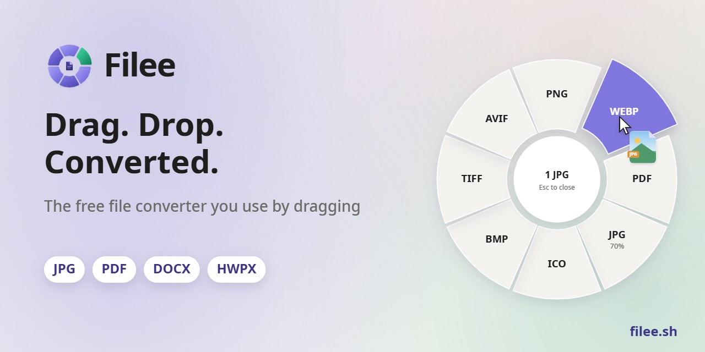
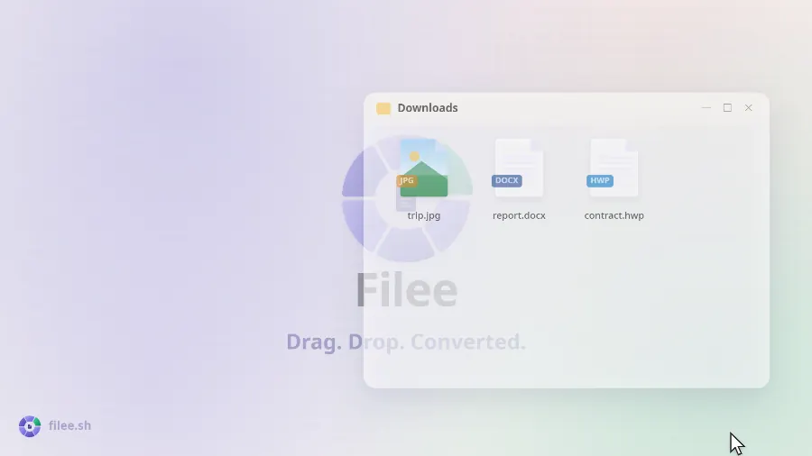
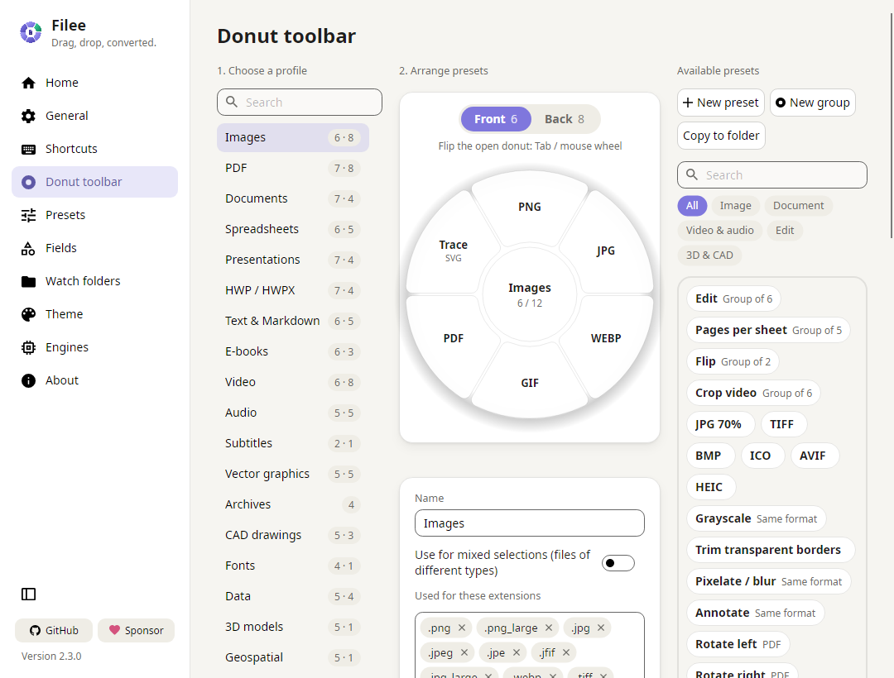
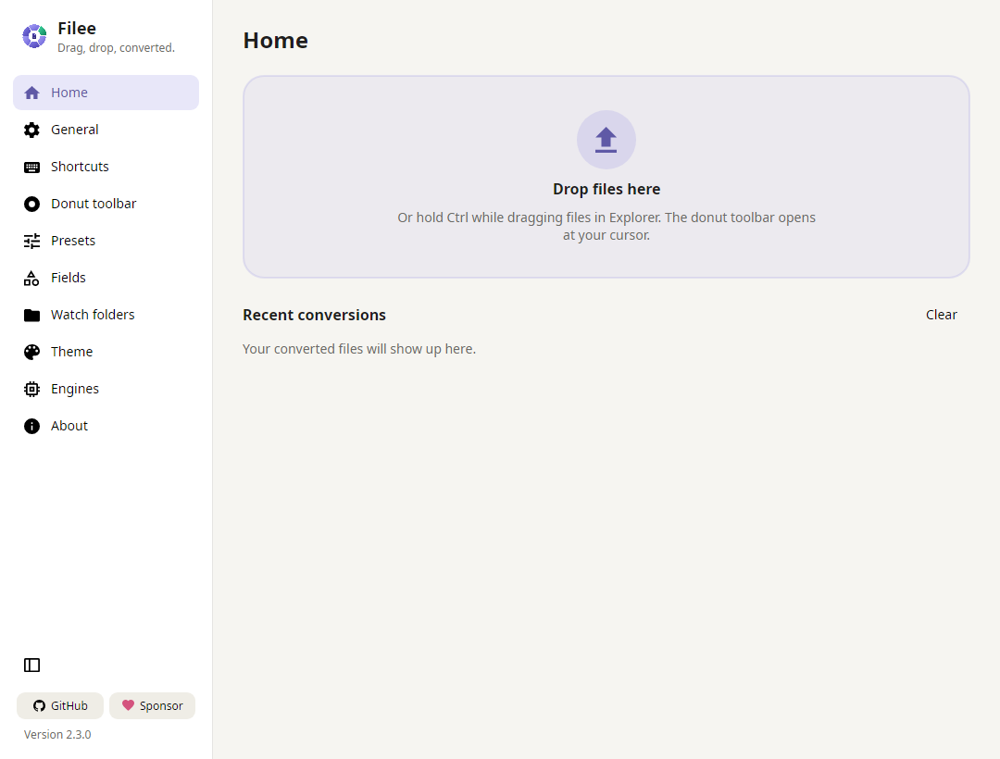

<p align="center">
  <a href="https://filee.sh"></a>
</p>

<p align="center" dir="rtl">
  <b>یک مبدل فایل رایگان و متن‌باز که با کشیدن و رها کردن کار می‌کند.</b><br>
  یک کلید را نگه دارید (<kbd>Ctrl</kbd>، یا <kbd>Option</kbd> در macOS)، فایل‌ها را بکشید و روی قالب مورد نظر در دوناتی که کنار مکان‌نما باز می‌شود رها کنید.
</p>

<p align="center" dir="rtl">
  <a href="https://filee.sh"><b>وب‌سایت</b></a> ·
  <a href="https://github.com/KnifeLemon/Filee/releases/latest"><b>دانلود</b></a> ·
  <a href="https://www.linkedin.com/company/filee-sh/"><b>لینکدین</b></a> ·
  <a href="#نصب">نصب</a> ·
  <a href="#خط-فرمان">خط فرمان</a> ·
  <a href="#توسعه">توسعه</a>
</p>

<p align="center" dir="ltr">
  <a href="https://github.com/KnifeLemon/Filee/actions/workflows/ci.yml"></a>
  <a href="https://github.com/KnifeLemon/Filee/releases/latest"></a>
  <a href="https://github.com/KnifeLemon/Filee/releases"></a>
  
  
  
  <a href="../../LICENSE"></a>
</p>

<p align="center" dir="ltr">
  <a href="https://trendshift.io/repositories/276987"></a>
  <a href="https://trendshift.io/repositories/276987"></a>
  <a href="https://hellogithub.com/repository/KnifeLemon/Filee" target="_blank"></a>
</p>

<p align="center" dir="ltr">
  <a href="../../README.md">English</a> ·
  <a href="README.es.md">Español</a> ·
  <a href="README.ja.md">日本語</a> ·
  <a href="README.ko.md">한국어</a> ·
  <a href="README.zh-CN.md">简体中文</a> ·
  <a href="README.zh-TW.md">繁體中文</a> ·
  <a href="README.pl.md">Polski</a> ·
  <a href="README.hi.md">हिन्दी</a> ·
  <a href="README.ru.md">Русский</a> ·
  <a href="README.ar.md">العربية</a> ·
  <b>فارسی</b> ·
  <a href="README.pt-BR.md">Português (Brasil)</a> ·
  <a href="README.pt-PT.md">Português (Portugal)</a> ·
  <a href="README.fr.md">Français</a> ·
  <a href="README.th.md">ไทย</a> ·
  <a href="README.tr.md">Türkçe</a> ·
  <a href="README.id.md">Bahasa Indonesia</a> ·
  <a href="README.it.md">Italiano</a> ·
  <a href="README.bn-BD.md">বাংলা</a>
</p>

<div dir="rtl">

<table>
  <tr>
    <td width="33%" valign="top">
      <b>دقیقاً کنار مکان‌نما</b><br>
      بدون نیاز به باز کردن پنجره برنامه.
      قالب‌ها دقیقاً در همان‌جایی که قرار دارید ظاهر می‌شوند و فقط قالب‌هایی نمایش داده می‌شوند که برای فایل‌های کشیده‌شده مناسب باشند.
    </td>
    <td width="33%" valign="top">
      <b>۲۷۰ قالب، بدون نرم‌افزار دیگر</b><br>
      تصاویر، PDF، Word، Excel، PowerPoint، HWP، کتاب‌های الکترونیکی، آرشیوها، فونت‌ها، CAD، مدل‌های سه‌بعدی و داده‌های مکانی بدون نیاز به آفیس، Hancom Office یا LibreOffice تبدیل می‌شوند.
    </td>
    <td width="33%" valign="top">
      <b>روی رایانه شما می‌ماند</b><br>
      هیچ فایلی آپلود نمی‌شود.
      Filee کاملاً آفلاین کار می‌کند و نتیجه را در کنار فایل اصلی ذخیره می‌نماید.
    </td>
  </tr>
</table>

## عملکرد برنامه در عمل

<p align="center">
  <a href="https://filee.sh"></a><br>
  <sub>ویدیوی ۲۷ ثانیه‌ای را تماشا کنید و دموی تعاملی را در <a href="https://filee.sh">filee.sh</a> امتحان نمایید</sub>
</p>

## نصب

از بخش [Releases](https://github.com/KnifeLemon/Filee/releases/latest) دانلود کنید.

<a href="https://apps.microsoft.com/detail/XPDCN05L89WS0C?referrer=appbadge&cid=github&mode=full"></a>

یا با WinGet:

```powershell
winget install KnifeLemon.Filee
```

- **ویندوز ۱۰ و ۱۱**: فایل `Filee-<version>-win-Setup.exe` را اجرا کنید، یا نسخه پرتابل `win-Portable.zip` را از حالت فشرده خارج کرده و `Filee.exe` را اجرا نمایید.
  - نصاب Filee نرم‌افزار اختصاصی خود آن است، به زبان‌های مختلف برنامه ارائه می‌شود و به برنامه دیگری نیاز ندارد.
  - می‌تواند منوی راست‌کلیک Explorer، اجرا در هنگام ورود به سیستم، دستور `filee` و موتورهای اختیاری را اضافه کند.
  - برای نصب بی‌صدا از سوئیچ‌های Inno Setup استفاده کنید (`/VERYSILENT /SUPPRESSMSGBOXES`).
- **مک‌او‌اس ۱۳ به بالا** (پیش‌نمایش): بسته `osx-arm64` یا `osx-x64` را استخراج کرده و `./install.sh` را اجرا کنید.
  - یا فایل `.dmg` را باز کرده و Filee را به Applications بکشید (دستور `filee` با `install.sh` نصب می‌شود).
  - این نسخه هنوز ثبت رسمی نشده است، بنابراین اولین اجرا را در System Settings → Privacy & Security → **Open Anyway** تأیید کنید.
- **لینوکس x64/ARM64** (اوبونتو ۲۲.۰۴ به بالا): بسته را استخراج کرده و `./install.sh` را اجرا کنید (بدون نیاز به دسترسی root، نیازمند پایتون ۳).
  - کشیدن و رها کردن به X11 نیاز دارد.
    در Wayland، از ناحیه رها کردن و منوی راست‌کلیک مدیر فایل استفاده کنید.

Filee نسخه‌های جدید را در منوی خود اطلاع می‌دهد و خود را به‌روزرسانی می‌کند و تنظیمات و موتورهای شما را حفظ می‌نماید.
پس از هر به‌روزرسانی، اسلایدهایی ویژگی‌های جدید را نشان می‌دهند.

**ویندوز: Filee اجرا نمی‌شود (بدون پنجره، بدون خطا)؟**
این مشکل در ویندوز ۱۰ که مدت‌ها به‌روزرسانی نشده باشد رخ می‌دهد، روی پردازنده‌هایی که از محافظت پشته مبتنی بر سخت‌افزار (CET) پشتیبانی می‌کنند.
ویندوز این محافظت را فعال کرده اما فاقد بخشی است که .NET نیاز دارد، بنابراین Filee و نصب‌کننده بلافاصله متوقف می‌شوند.

- **پیشنهاد می‌شود:** به‌روزرسانی‌های ویندوز را نصب کنید (آخرین بسته تجمعی).
- **در صورتی که امکان به‌روزرسانی نیست:** غیرفعال کردن محافظت برای Filee مشکل را حل می‌کند.
  این دستورات را در PowerShell با دسترسی Administrator اجرا کنید:

```powershell
Set-ProcessMitigation -Name Filee.exe -Disable UserShadowStack
Set-ProcessMitigation -Name filee-cli.exe -Disable UserShadowStack
```

همین کار را با نام فایل نصاب نیز انجام دهید (مانند `Filee-<version>-win-Setup.exe`)، یا از نسخه پرتابل استفاده کنید که فقط به این دو سطر نیاز دارد.
برای بازگردانی، این ورودی‌ها را در Windows Security → App & browser control → Exploit protection settings → Program settings حذف کنید.

## قابلیت‌ها

- **دونات کنار مکان‌نما**: یک کلید را نگه دارید، فایل‌ها را بکشید و روی قالب رها کنید.
  تنها قالب‌های سازگار با فایل ظاهر می‌شوند.
- **مستقیماً از مرورگر**: تصویر، لینک فایل یا دانلود را از کروم، اج، فایرفاکس یا سافاری به همان روش بکشید.
  - Filee آن را در پوشه Downloads ذخیره کرده (یا فقط نسخه تبدیل‌شده را نگه می‌دارد) و تبدیل را انجام می‌دهد.
  - لینک‌ها بدون نیاز به حساب کاربری مرورگر دانلود می‌شوند.
- **یک نوار ابزار مجزا برای هر نوع فایل** با چیدمان دلخواه با کشیدن و رها کردن، شامل پیش‌تنظیمات برای:
  - کیفیت، اندازه، DPI
  - صفحات PDF و فشرده‌سازی
  - ویدیو و صدا
  - پوشه خروجی و نام فایل‌ها
- **دو روی هر دونات**: کلید <kbd>Tab</kbd> را فشار دهید یا چرخ ماوس را بچرخانید تا به قالب‌ها و ابزارهای کمتر رایج دسترسی پیدا کنید.
- **برش قبل از تبدیل**: بخش Crop تصاویر را تک‌تک باز می‌کند.
  کادر را بکشید، نسبت تصویر را انتخاب کنید و فقط همان بخش ذخیره می‌شود.
- **تبدیل همزمان چند فایل** به صورت موازی.
  مسیرهای چندمرحله‌ای (HWP → HWPX → DOCX) به طور خودکار شناسایی می‌شوند.
- **پوشه‌های نظارتی (Watch folders)** هر فایلی را که درون آن‌ها ریخته شود تبدیل می‌کنند.
- **تبدیل‌های اخیر** در صفحه اصلی با پیش‌نمایش تصویر کوچک: نتیجه را باز کنید یا با برنامه دیگری اجرا نمایید.
- **لیست فایل‌ها در صفحه اصلی**: گزینه *جمع‌آوری فایل‌های رها شده در لیست* را در تنظیمات عمومی فعال کنید تا فایل‌های رها شده در صفحه اصلی به جای باز شدن دونات در یک لیست قرار گیرند.
  با کشیدن کارت‌ها یا Alt+↑ / Alt+↓ ترتیب را تغییر دهید، با Delete حذف کنید، و با *انتخاب عملکرد* دونات را برای کل لیست باز کنید.
  لیست با اتمام تبدیل خالی می‌شود.
- **روش‌های دیگر دسترسی**: منوی راست‌کلیک، میانبر کیبورد، ناحیه رها کردن و دستور [`filee`](#خط-فرمان).
- پوسته‌های روشن و تیره با رنگ تأکیدی دلخواه و شفافیت دونات، به زبان‌های انگلیسی، اسپانیایی، ژاپنی، کره‌ای، چینی ساده و سنتی، لهستانی، هندی، روسی، عربی (راست به چپ)، پرتغالی (برزیل و پرتغال)، فرانسوی، نپالی، تایلندی، ترکی، آلمانی، ایتالیایی، اندونزیایی، ویتنامی و فارسی (راست به چپ).

## تصاویر برنامه

<table>
  <tr>
    <td width="50%"></td>
    <td width="50%"></td>
  </tr>
  <tr>
    <td align="center"><sub>چیدمان دونات با کشیدن و رها کردن، یک نمایه برای هر نوع فایل</sub></td>
    <td align="center"><sub>صفحه اصلی: ناحیه رها کردن و تبدیل‌های اخیر</sub></td>
  </tr>
</table>

## قالب‌ها

| از | به |
|---|---|
| **تصاویر**: JPG، PNG، WEBP، AVIF، TIFF، BMP، GIF، APNG، ICO، ICNS، JPEG XL، JPEG 2000، PSD/PSB، TGA، PPM، HEIC، QOI، DDS، PCX، MNG، CUR، …؛<br>خواندن GIMP XCF، فایل خام دوربین (CR2، CR3، NEF، ARW، DNG، …)، DICOM، OpenEXR، HDR، FITS، JPEG XR (ویندوز)، Live Photo آیفون (LIVP) | به هر یک از این قالب‌ها (HEIC⁵)، PDF، SVG (وکتور شده)، تغییر ابعاد، سیاه‌وسفید؛<br>Live/Motion Photo (آیفون، اندروید) → ویدیوی درون آن (MP4، MOV⁵)، و تبدیل ویدیو → Live Photo (آیفون) یا Motion Photo (اندروید)⁵، آزمایشی |
| **وکتور**: SVG، SVGZ، EMF، WMF، AI<br>EPS، PS¹<br>CDR، VSD، CGM، ODG، FODG² | PDF (وکتور)، PNG و سایر تصاویر،<br>SVG ↔ SVGZ، SVG → DXF/DWG، PDF → EPS/PS¹، SVG → EMF، WMF، ODG² |
| **PDF** | DOCX، HWPX، TXT، PNG، JPG، TIFF، CBZ، PPTX (تصویر هر صفحه)، SVG²؛<br>ادغام (با انتخاب ترتیب)، تقسیم، محدوده صفحات، فشرده‌سازی (کاهش حجم PDF) |
| **اسناد**: DOCX، DOCM، DOTX، EML، پیام Outlook MSG؛<br>خواندن OFD (فاکتورهای الکترونیکی و اسناد رسمی چینی)<br>DOC، ODT، FODT، OTT، RTF، WPS، WPD، Pages، ClarisWorks، MacWrite، T602، …² | PDF، DOCX، HWPX، EPUB، TXT، HTML؛<br>MSG → EML<br>ODT، FODT، OTT² |
| **صفحات گسترده**: XLSX، XLSM، XLS، XLT، ODS، CSV، TSV<br>OTS، FODS، Numbers، ET² | PDF، XLSX، ODS، CSV، TSV، JSON، HWPX، HTML<br>XLT، OTS² |
| **ارائه‌ها**: PPTX، PPTM، POTX، POTM، PPSX<br>PPT، ODP، OTP، FODP، Keynote² | PDF، PNG، JPG، DOCX، HWPX<br>OTP² |
| **HWP**: HWP، HWPX | PDF، PNG، DOCX، HWPX ↔ HWP، TXT، Markdown، HTML |
| **متن**: TXT، LOG، کدهای اسکریپت (PY، PAC، BAT، COMMAND؛ فقط خواندن، هرگز اجرا نمی‌شود)، Markdown، HTML؛<br>خواندن MHTML (صفحات وب ذخیره‌شده)<br>reStructuredText، LaTeX، Org، AsciiDoc، Typst، MediaWiki، DocBook، Jupyter، Textile، man، OPML³ | UTF-8 TXT، PDF، DOCX، HWPX، EPUB<br>تبدیل به یکدیگر، اسلایدهای PPTX³ |
| **کتاب‌های الکترونیکی**: EPUB، KEPUB، MOBI، AZW3، AZW، AZW4، FB2، CBZ، CBR، CB7، HTMLZ، TXTZ<br>LIT، LRF، CHM، PDB، …⁴ | PDF، EPUB، KEPUB (Kobo)، DOCX، TXT، HTML، HWPX<br>MOBI، AZW3⁴ |
| **ویدیو**⁵: MP4، MOV، MKV، WEBM، AVI، WMV، FLV، MPEG، ویدیو سی‌دی (DAT)، TS، M2TS، 3GP، OGV، VOB، … | MP4 (H.264، HEVC، AV1)، WEBM، MOV، MKV، AVI، GIF، APNG، MP3، M4A، 720p،<br>زیرنویس‌ها (SRT، ASS، WebVTT) |
| **صدا**⁵: MP3، M4A، AAC، WAV، FLAC، OGG، OPUS، WMA، AIFF، AMR، APE، WavPack، TTA، DSD (DSF، DFF)، DTS، AC3، E-AC3، … | MP3، M4A (AAC، ALAC)، WAV، FLAC، OGG، OPUS، AAC، WavPack، TTA، W64، AC3، E-AC3 |
| **زیرنویس**: SRT، ASS/SSA، WebVTT، SAMI (SMI)، LRC، TTML، MicroDVD، SCC | تبدیل به یکدیگر در قالب UTF-8 (فایل‌های CP949 کره‌ای به درستی خوانده می‌شوند) |
| **آرشیوها**: ZIP، ANSYS Workbench (WBPZ)، 7Z، RAR، TAR، TAR.GZ، TAR.BZ2، TAR.XZ، GZ، ISO، CAB، DMG، ALZ، EGG، … | استخراج، ZIP، 7Z، TAR، TAR.GZ؛<br>هر فایلی → یک فایل ZIP |
| **CAD**: DWG، DXF | PDF، SVG، PNG، DWG ↔ DXF |
| **فونت‌ها**: TTF، OTF، WOFF، WOFF2، EOT؛<br>خواندن FON (فونت‌های بیت‌مپ ویندوز) | تبدیل به یکدیگر؛<br>FON → یک فونت برای هر اندازه |
| **داده‌ها**: JSON، JSON Lines، YAML، TOML، XML<br>vCard، iCalendar | تبدیل به یکدیگر، CSV و XLSX (جداول)؛<br>vCard، iCalendar ↔ CSV |
| **مدل‌های سه‌بعدی**: GLB، glTF، STL، OBJ (+ MTL)، 3MF، PLY؛<br>خواندن FBX | تبدیل به یکدیگر، پیش‌نمایش PNG |
| **وکتورهای مکانی**: Shapefile، GeoJSON، KML، KMZ، GPX<br>CSV با مختصات؛ خواندن Garmin FIT | تبدیل به یکدیگر و CSV / XLSX / JSON؛<br>داده‌های پیش‌افکنده (UTM، Web Mercator، Lambert، Albers) به صورت طول و عرض جغرافیایی WGS 84 تبدیل می‌شوند |

قالب‌های بدون علامت به صورت پیش‌فرض و بدون نیاز به آفیس، Hancom Office یا LibreOffice تبدیل می‌شوند.
قالب‌های دارای علامت به موتورهای اختیاری نیاز دارند که تنها در صورت تمایل دانلود می‌شوند: ¹ Ghostscript، ² LibreOffice، ³ Pandoc، ⁴ calibre، ⁵ FFmpeg ([اطلاعات بیشتر](../../docs/ENGINES.md)).

## خط فرمان

دستور `filee` از همان موتورها و پیش‌تنظیمات برنامه استفاده می‌کند (نصاب یا `install.sh` آن را اضافه می‌کند).

```
filee convert photo.heic --to jpg
filee convert *.png --to webp --quality 80 -o converted
filee watch D:\Inbox --to pdf --move-originals
```

همه دستورات و گزینه‌ها: [filee.sh/cli](https://filee.sh/cli/) یا `filee help`.

## توسعه

با .NET 10 SDK روی ویندوز، مک یا لینوکس بیلد بگیرید:

```bash
git clone https://github.com/KnifeLemon/Filee.git
cd Filee
pwsh build/fetch-engines.ps1 -Only rhwp,pandoc   # موتورهای اختیاری
dotnet run --project src/Filee.App
dotnet test
```

[معماری](../../docs/ARCHITECTURE.md) · [موتورها](../../docs/ENGINES.md) · [افزودن مبدل](../../docs/ADDING-A-CONVERTER.md) · [افزودن زبان](../../docs/ADDING-A-LANGUAGE.md) · [مشارکت](../../CONTRIBUTING.md)

از مشارکت و ارسال Pull Request استقبال می‌کنیم.
اگر Filee در کارهای روزمره به شما کمک می‌کند، دادن یک ⭐ به پیدا شدن آن توسط دیگران کمک می‌کند.

## خط‌مشی امضای کد

Filee توسط **Myeonggu Kim** ([KnifeLemon](https://github.com/KnifeLemon)) توسعه یافته و منتشر می‌شود.

- نسخه‌های ویندوز با گواهی امضای کد متن‌باز [Certum](https://www.certum.eu/) متعلق به Myeonggu Kim امضا شده‌اند ("Open Source Developer MYEONGGU KIM").
  - نسخه‌های قبلی تا 2.0.0 امضا نشده بودند.
  - اسمارت‌اسکرین ویندوز ممکن است تا زمان دانلود کافی به نسخه جدید هشدار دهد ("More info" → "Run anyway").
- بسته‌های macOS به صورت موقت (ad-hoc) امضا شده و هنوز ثبت رسمی نشده‌اند.
- تنها فایل‌های ساخته‌شده توسط گردش کار انتشار GitHub Actions این مخزن امضا می‌شوند، و هر انتشار به صورت دستی بررسی و امضا می‌گردد.
  - کتابخانه‌ها و برنامه‌هایی که سازندگانشان آن‌ها را امضا کرده‌اند (.NET، SkiaSharp، ImageMagick، C++ runtime مایکروسافت…) امضای خود را حفظ می‌کنند؛ موارد بدون امضا (مانند rhwp، 7-Zip و بیشتر کتابخانه‌ها) با گواهی Filee امضا می‌شوند.

### خط‌مشی حفظ حریم خصوصی

Filee فایل‌ها را روی رایانه شما تبدیل می‌کند و هرگز آن‌ها را آپلود نمی‌کند.
هیچ داده‌ای از نحوه استفاده شما جمع‌آوری نمی‌شود و اطلاعات تله‌متری ارسال نمی‌گردد.
اتصال به اینترنت فقط در موارد زیر انجام می‌شود:

- برای بررسی اینکه نسخه جدیدتری در گیت‌هاب (`api.github.com`) موجود است یا خیر؛ کمی پس از اجرا و سپس هر چند ساعت یک‌بار.
  می‌توانید این قابلیت را در تنظیمات → درباره ("بررسی خودکار برای به‌روزرسانی") غیرفعال کنید.
- برای دانلود موتورهای تبدیلی که خودتان نصب آن‌ها را انتخاب می‌کنید، از آدرس‌های رسمی مشخص‌شده در [`engines.json`](../../src/Filee.Engines/Infrastructure/engines.json)، و زبان‌های تشخیص متن (OCR) مورد استفاده یک پیش‌تنظیم در [`ocr-languages.json`](../../src/Filee.Engines/Infrastructure/ocr-languages.json).
- هنگام کلیک روی یک پیوند، که مرورگر وب شما را باز می‌کند.

## حمایت مالی

Filee رایگان است و رایگان خواهد ماند.
اگر مایل به حمایت هستید، هر روشی که برایتان مناسب است را انتخاب کنید ([Fairy](https://fairy.hada.io/@filee) کارت‌های کره‌ای و پرداخت آسان را می‌پذیرد).

**نام یا نشان شما در اینجا.**
حامیان ماهانه با نام در اینجا ذکر می‌شوند و حامیان ویژه لوگوی خود را در اینجا و صفحه درباره Filee دریافت می‌کنند.
حامیان یک‌باره نیز در صورت تمایل می‌توانند در لیست قرار گیرند.

<!-- sponsors: src/Filee.App/Assets/Sponsors/sponsors.json -->

<p align="center" dir="ltr">
  <a href="https://github.com/sponsors/KnifeLemon"></a>
  <a href="https://patreon.com/KnifeLemon"></a>
  <a href="https://ko-fi.com/knifelemon"></a>
  <a href="https://paypal.me/knifelemon"></a>
  <a href="https://fairy.hada.io/@filee"></a>
</p>

## مجوز

مجوز MIT، © 2026 Myeonggu Kim (KnifeLemon) و مشارکت‌کنندگان Filee.
بخش‌های شخص ثالث همراه دارای مجوزهای مختص خود هستند که در [THIRD-PARTY-NOTICES.md](../../THIRD-PARTY-NOTICES.md) فهرست شده‌اند.

<p align="center">
  <a href="https://star-history.com/#KnifeLemon/Filee&Date"></a>
</p>

</div>
